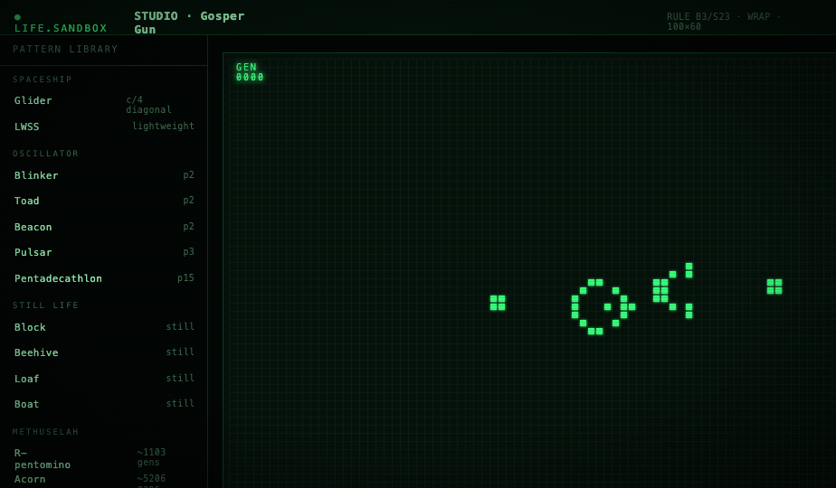

# GameOfLife — Computational Sandbox

[](https://github.com/aifriend/gameoflife-sandbox/actions/workflows/ci.yml)
[](https://www.python.org/)
[](LICENSE)

A research environment for Conway's Game of Life: rules, patterns, period
analysis, and the path from glider collisions to Turing-completeness.



Two ways to use it:

- **Python sandbox** — engine, RLE patterns, period detection, pygame
  viewer, matplotlib animations, gun/eater primitives. Best for
  scripted experiments and offline analysis.
- **Web Studio** — interactive 3-pane UI in the browser, retro CRT
  phosphor aesthetic. Best for poking at patterns in real time.

```bash
git clone https://github.com/aifriend/gameoflife-sandbox.git
cd gameoflife-sandbox
./setup.sh                       # one-time: venv, deps, run tests
```

## Web Studio

```bash
./scripts/launch_web.sh          # port 5173 by default
```

Auto-frees the port if a stale launcher is holding it, starts
`http.server`, opens your browser at `http://localhost:5173/`, and
tails the access log. Ctrl+C cleans up. Pick another port with
`./scripts/launch_web.sh 8080`.

Three panes: pattern library (left), live canvas with glow + scanlines
(center), B/S rule builder + telemetry + 240-gen population trace
(right). Click to paint, drag to draw, run / step / reload / soup /
clear, toggle each rule digit, switch between Conway / HighLife /
Seeds / Gnarl / Life w/o Death / 34 Life / Day & Night / Diamoeba.
Full controls in [web/README.md](web/README.md).

## Python sandbox

```bash
source .venv/bin/activate

python scripts/list_patterns.py --verify
python scripts/analyze_pattern.py r_pentomino --max-steps 1500 --plot
python scripts/run_simulation.py --pattern gosper_glider_gun
python scripts/animate.py glider --steps 40 --out glider.gif
```

[README_SANDBOX.md](README_SANDBOX.md) has the full guided tour:
loading patterns, building gates from glider streams, rendering
animations, and exploring custom rules.

## What's inside

```
gameoflife/
    engine.py     — fast convolution-based Life engine, custom B/S rules
    patterns.py   — RLE parser/writer + bundled PatternLibrary
    analysis.py   — period detection, population trace, displacement
    visualize.py  — pygame interactive viewer + matplotlib animation
    gates.py      — gun/eater/glider primitives for logic constructions

patterns/                              # 22 verified canonical RLE files
    spaceships/   — glider, LWSS, MWSS, HWSS
    oscillators/  — blinker, toad, beacon, pulsar, pentadecathlon
    still_lifes/  — block, beehive, loaf, boat, tub
    methuselahs/  — R-pentomino, acorn, diehard, bunnies
    guns/         — Gosper glider gun, Simkin glider gun
    exotic/       — eater 1, glider collisions
    logic/        — README on building gates from glider streams
    turing/       — README on UTM constructions, OTCA metapixel, etc.

scripts/
    run_simulation.py   — interactive pygame viewer
    analyze_pattern.py  — period detection + population plot
    animate.py          — render to GIF/MP4
    glider_demo.py      — collision and gun+eater demos
    list_patterns.py    — index of all bundled patterns
    launch_web.sh       — start the Web Studio with one command

web/                                   # React + Canvas Studio UI
    index.html        — entry point, no build step
    life-engine.js    — pure-JS LifeBoard (parity with Python engine)
    life-app.jsx      — Studio React component
    README.md         — controls and run instructions
```

## Tests

53 tests across engine correctness, RLE round-trip, pattern
verification, analysis edge cases, scipy/numpy backend equivalence.
CI runs them on Python 3.9, 3.10, 3.11, 3.12.

```bash
pytest -q
```

## Contributing

See [CONTRIBUTING.md](CONTRIBUTING.md). Bug reports, new patterns,
new analysis tools, and documentation fixes are all welcome.

## License

MIT — see [LICENSE](LICENSE). Patterns in `patterns/` are canonical
shapes from LifeWiki and are not subject to copyright.
